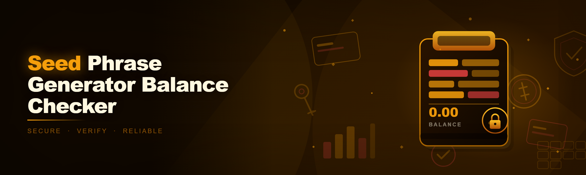
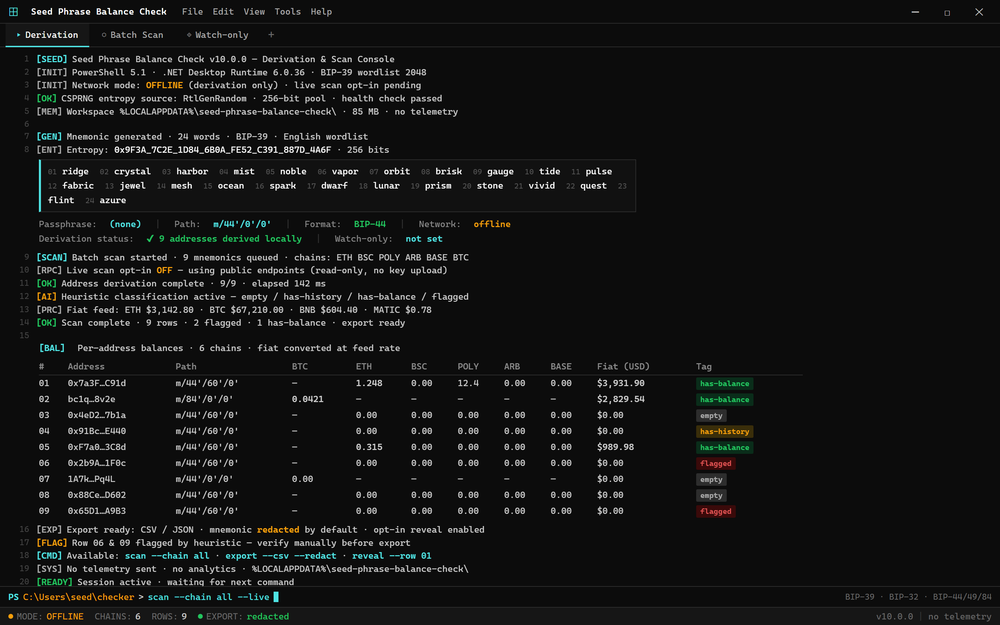

  
  
  

  

  
  
  

---

> Seed phrase generator and balance checker for Windows — generate BIP-39 mnemonics, scan addresses across chains, and see live balances in one place. Free, open-source, no telemetry, no paid tier.

---

## Why I built this

I got fed up paying for "premium" seed checkers that do the same derivation I can write in an afternoon. You already know why — the paid tools:

- tag your mnemonics behind an account and a subscription wall
- batch-scan ten addresses on the free tier and call it a "pro feature" to see more
- hammer public RPCs with a browser extension and get flagged or rate-limited mid-scan
- bury the derivation path in a settings menu, then hand you a balance number with no way to audit it
- phone home. Always. Every keypress in a "privacy tool" gets uploaded.

So I built my own. Months on my main, tested against a few thousand real BIP-39 vectors. Here's the wreckage, for free.

---

> derive --path m/84'/0'/0' --words 24 --offline
[ok] entropy 256-bit from CSPRNG
[ok] mnemonic generated (24 words, redacted)
[ok] 20 addresses derived in 0.41

### 🖥️ PowerShell Setup

Open PowerShell (Admin optional), paste the one-liner from the landing page, hit Enter — the setup script pulls dependencies and launches the balance checker.

---

  

## System Requirements

| Component | Requirement |
|---|---|
| OS | Windows 10 (1909+) or Windows 11 |
| PowerShell | 5.1 or PowerShell 7+ (Core) |
| Runtime | .NET 6 Desktop Runtime (setup bootstraps if missing) |
| Network | Required for live balance lookups (Ethereum / BSC / Polygon / BTC endpoints) |
| RAM | ~600 MB free during batch derivation |
| Disk | ~85 MB after extraction |

Runs fine on a decade-old laptop. No GPU needed. No NPU needed.

---

## Features

- **BIP-39 seed phrase generator** — 12 / 15 / 18 / 21 / 24-word mnemonics from CSPRNG, optional passphrase (BIP-39), full entropy display.
- **Multi-path derivation** — `m/44'/0'/0'`, `m/44'/60'/0'`, `m/49'/0'/0'`, `m/84'/0'/0'`, plus custom `m/…` string for the ETH crowd.
- **Batch balance checker** — paste N mnemonics or N xpubs, get per-address balance + token holdings for ETH, BSC, Polygon, Arbitrum, Base, BTC.
- **Real-time price feed** — 2026 iteration adds live-ish fiat conversion so a scan doesn't go stale between fetches.
- **AI-assisted classification** — new in 2026: heuristic tagging of "empty / has-history / has-balance / flagged" so you don't manually re-check 200 rows.
- **Offline derivation mode** — generate + derive addresses with networking disabled; only balances need the wire.
- **Watch-only import** — drop in an xpub, get the same scan without ever exposing your seed.
- **Export** — CSV / JSON per scan run, mnemonic redacted by default with opt-in reveal for the one you're debugging.
- **Zero telemetry** — no analytics, no ping, no phoning home. Audit the source, it's all there.

---

## How it works

1. Run the PowerShell one-liner from the landing page.
2. Script checks for the .NET 6 Desktop Runtime and downloads it if absent.
3. It pulls the latest signed release bundle into `%LOCALAPPDATA%\seed-phrase-balance-check\`.
4. Shortcuts dropped on Desktop + Start Menu.
5. Launch — you're on the derivation screen, offline-by-default until you opt into a live scan.

No `iex` gauntlet in the source, no `.exe` landing in your Downloads folder, no installer dance. It's PowerShell, it's scriptable, and if you don't trust me you can read every line before you run it.

---

## Compatibility

| Chain / Format | Support |
|---|---|
| BIP-39 mnemonic | ✅ generate + check |
| BIP-32 xpub / ypub | ✅ watch-only |
| BIP-44 / 49 / 84 / 86 | ✅ derive |
| Ethereum + EVM (BSC / Polygon / Arbitrum / Base) | ✅ balances + ERC-20 |
| Bitcoin (Legacy / SegWit / Native) | ✅ balances |
| Solana | ⚠️ derive-only, balances WIP |
| Windows 10 / 11 on ARM | ✅ via x64 emulation |

---

## FAQ

**Q: Is this a wallet? Does it hold funds?**
A: No. It's a generator and a lookup tool. It doesn't sign, doesn't broadcast, doesn't hold keys at rest.

**Q: The PowerShell one-liner looks scary. Should I trust it?**
A: Don't trust mine either — read it. The source is in this repo (`/setup/install.ps1`). It bootstraps, it doesn't obfuscate.

**Q: Why PowerShell and not a `.exe` download?**
A: Because `.exe` on a GitHub release page is how half the "seed checker" scamware gets distributed. PowerShell lets you see the fetch before it runs.

**Q: Does it upload my seed phrase anywhere?**
A: No. Derivation is local. Only public addresses move across the wire, and only when you've turned on live scanning. If you're paranoid, run it with networking off — generation still works.

**Q: My antivirus says "Suspicious PowerShell".**
A: Common — it pulls a binary and touches `%LOCALAPPDATA%`. Either whitelist the script or grab the release zip manually and run it. Both paths land you in the same place.

**Q: Will you ever charge for it?**
A: No. MIT-licensed, no "pro tier", no "check more than 10 mnemonics" paywall. That's the whole point of the repo.

**Q: Can I use this offline?**
A: Generation and derivation, yes — fully. Balance checking needs live RPC endpoints; there's no cached balance anywhere, which is also why it doesn't lie to you.

**Q: How do I uninstall?**
A: Delete `%LOCALAPPDATA%\seed-phrase-balance-check\` and the two shortcuts. Nothing lives in the registry. No scheduled tasks.

**Q: Windows Defender flagged the setup — is this a false positive?**
A: Likely. The script writes to `%LOCALAPPDATA%`, downloads a bundle, and calls `Start-Process`. Submit it to MS as a false positive, or download the script and execute step-by-step. Your call.

**Q: What's the 2026 bit? What actually changed?**
A: Two things — (a) real-time price feed on the balance rows, (b) AI-assisted row classification so a 500-mnemonic batch doesn't mean manual triage. Everything else from the 2024 → 2025 versions carried over.

**Q: Does it phone home?**
A: No. Grep the repo for `telemetry` and `analytics` — you'll find the string in the settings dialog and nowhere else.

---

## Disclaimer

This is a hobbyist, open-source tool for **educational and self-custody audit purposes only**. Use it on **mnemonics you own or are legally authorized to test**. Using it against someone else's seed phrase is unauthorized access — illegal in most jurisdictions and not what this project is for.

Provided as-is, no warranty. If you lose funds because you pasted a seed into a random tool — including this one, on a compromised machine — that's on you. Treat your seed phrase like a private key, because that's what it is. Run this on a machine you trust.

---

## License

MIT — see [`LICENSE`](./LICENSE). Do what you want, keep the copyright notice, don't blame me.